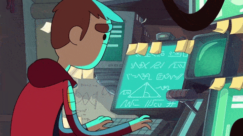
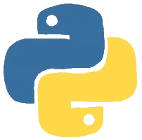
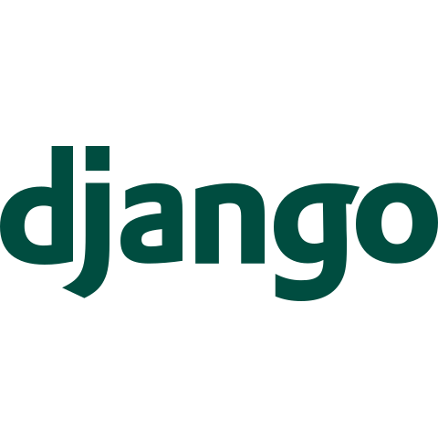

<!-- Animated profile header -->
<div align="center">
  
  <br/>

  
  <br/>
  <a href="https://github.com/Harish-Raja-R"></a>
  <a href="https://github.com/Harish-Raja-R?tab=followers"></a>
</div>

---

## ☕ About Me

<div align="center">
  
</div>

<table>
  <tr>
    <td width="64%" valign="middle">
      <h3>👋 Hello, World!</h3>
      <p>🎓 I'm pursuing an <b>Integrated M.Sc. in Artificial Intelligence &amp; Machine Learning</b> at <b>Coimbatore Institute of Technology (CIT)</b>.</p>
      <p>💻 I'm a developer who enjoys working at the intersection of <b>software engineering and AI</b> — from crafting full-stack applications and APIs to experimenting with machine learning models.</p>
      <p>🧠 I’m especially curious about how intelligent systems can become more <b>reliable, explainable, and useful</b> in real-world applications.</p>
      <p>🚀 I learn by building: exploring an idea, experimenting with technologies, solving problems, and turning the results into working prototypes.</p>
      <h3>⚡ What I'm up to</h3>
      <p>🔹 Developing full-stack apps with modern frontend and backend tools<br/>
      🔹 Exploring deep learning, NLP, transformers, and computer vision<br/>
      🔹 Investigating RAG hallucination detection and AI reliability<br/>
      🔹 Learning about federated learning and privacy-aware AI<br/>
      🔹 Sharpening DSA and software engineering fundamentals</p>
      <p><b>💡 My approach:</b> Stay curious. Build with purpose. Keep improving.</p>
    </td>
    <td width="36%" align="center" valign="middle">
      
      <br/>
      
      
      
      <br/><sub><b>Code • Learn • Build • Repeat</b></sub>
    </td>
  </tr>
</table>

<div align="center">
  
</div>

---

## 🧑‍💻 Developer Snapshot

```python
class HarishRaja:
    pronouns = "he/him"
    education = "Integrated M.Sc. AI & ML — CIT"
    roles = ["Software Developer", "AI/ML Developer"]

    languages = [
        "Python", "JavaScript", "TypeScript", "R",
        "C", "HTML", "CSS", "SQL"
    ]

    interests = [
        "Full-Stack Development",
        "Machine Learning & Deep Learning",
        "NLP & Computer Vision",
        "RAG Evaluation & AI Reliability",
        "Federated Learning"
    ]

    motto = "Learn continuously. Build thoughtfully. Ship boldly."
```

## ⚡ Tech Stack

<div align="center">
  <h3>Languages</h3>
  
  <h3>Frontend & Backend</h3>
  
  <h3>AI, ML & Data</h3>
  
  <br/>
  
  
  
  <h3>Databases, DevOps & Tools</h3>
  
</div>

## 🚀 Featured Projects

| Project | Description | Stack |
|---|---|---|
| [**ComplyOne**](https://github.com/Harish-Raja-R/complyone) | Full-stack compliance management platform | React, Vite, Node.js, MongoDB |
| **VULTRA** | Vulnerability intelligence platform | FastAPI, React, TypeScript |
| **A.U.R.A. Filter** | Hybrid fake-news and deepfake detection | BERT, ResNet, Flask |
| **RAGGuard** | Hallucination detection in RAG answers | Python, NLP, classical ML |
| **CrisisMesh** | Decentralized emergency communication concept | Android, P2P, AI |
| **SmartPredict-PdM** | Predictive maintenance and failure-risk modelling | Python, Scikit-learn, Streamlit |

<div align="center">
  
  <br/>
  <i>Turning ideas into experiments, prototypes, and working software.</i>
</div>

➡️ Explore all my work: **[GitHub Repositories](https://github.com/Harish-Raja-R?tab=repositories)**

## 📊 GitHub Analytics

<div align="center">
  
  
  <br/>
  
  <br/>
  
</div>

## 🐍 Contribution Journey

<div align="center">
  
</div>

## 🎯 Currently Exploring

<div align="center">
  
  
  
  
  
</div>

- Reliable AI systems, RAG evaluation, and hallucination detection
- Federated learning for privacy-aware machine learning
- Full-stack product development and API design
- Data structures, algorithms, and problem solving

## 🤝 Let's Connect

<div align="center">
  <a href="https://github.com/Harish-Raja-R"></a>
  <a href="https://sitessy.in"></a>
  <a href="https://www.linkedin.com/"></a>
</div>

<div align="center">
  
  <b>Thanks for visiting! Let's build something meaningful.</b>
  
  <br/><br/>
  
</div>
